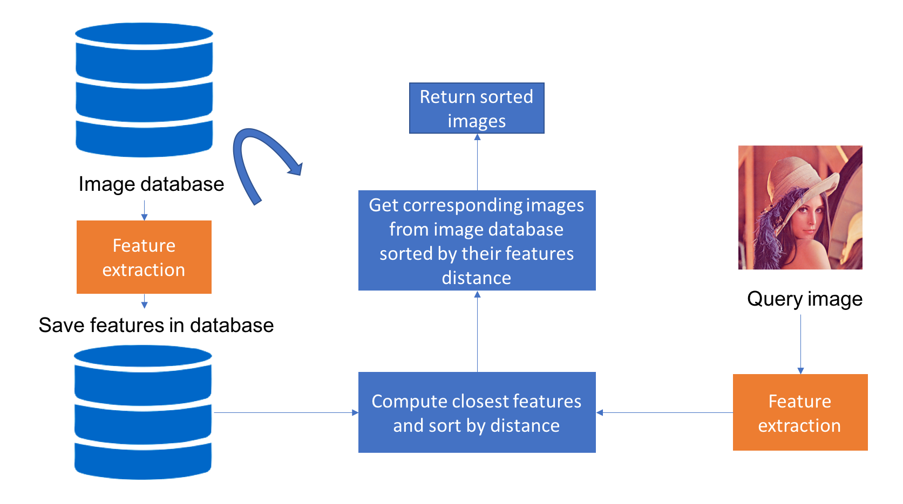

# Content-based Image Retrieval (CBIR)



A system that finds similar images using visual features rather than metadata. This project compares various feature
extraction algorithms and similarity metrics to determine the most effective combination for image retrieval tasks.

## Table of Contents

1. [Overview](#overview)
2. [Project Structure](#project-structure)
3. [Installation](#installation)
4. [Usage](#usage)
5. [Results and Findings](#results-and-findings)
6. [License](#license)

## Overview

[Content-based image retrieval](https://en.wikipedia.org/wiki/Content-based_image_retrieval) (CBIR) is a computer
vision technique for searching digital images in large databases based on their visual content rather than metadata
or text annotations.

The process consists of four steps:
1. Extract features from an image database to form a feature database
2. Extract features from the query image
3. Find the most similar features in the database
4. Return the images associated with the most similar features

### Research Objective

This project compares different combinations of feature extraction algorithms and similarity metrics to identify
the most effective approach for image retrieval tasks.

#### Feature Extraction Methods
* Traditional Computer Vision, as a [bag of visual words](https://en.wikipedia.org/wiki/Bag-of-words_model_in_computer_vision)
  (512-word vocabulary learned on the gallery split, Hamming assignment of the binary descriptors):
  * [AKAZE](https://docs.opencv.org/4.x/db/d70/tutorial_akaze_matching.html) - Fast local feature detector and descriptor
  * [ORB](https://docs.opencv.org/4.x/d1/d89/tutorial_py_orb.html) - Oriented FAST and Rotated BRIEF features
* Deep Learning, pretrained networks loaded with [timm](https://github.com/huggingface/pytorch-image-models), each
  with its prescribed preprocessing:
  * [VGG16](https://neurohive.io/en/popular-networks/vgg16/) - 16-layer CNN, last dense layer before classification (4096)
  * [NasNet](https://paperswithcode.com/model/nasnet?variant=nasnetalarge) - NASNetLarge, global average pooling (4032)
  * [EfficientNet](https://paperswithcode.com/method/efficientnet) - EfficientNet-B7, global average pooling (2560)
  * [ConvNeXt](https://arxiv.org/abs/2201.03545) - ConvNeXt-Tiny, a modern CNN of modest size (768)
  * [DINOv2](https://github.com/facebookresearch/dinov2) - ViT-B/14, self-supervised (768)
  * [SigLIP 2](https://arxiv.org/abs/2502.14786) - ViT-B/16, image-text pretraining, image encoder (768)

#### Similarity Measures

Search is exact (brute force), so differences come from the features and the measure, not from an approximate index.

* [Cosine Distance](https://en.wikipedia.org/wiki/Cosine_similarity) - 1 minus the cosine similarity; compares directions only
* [Manhattan Distance](https://en.wikipedia.org/wiki/Manhattan_distance) - Sum of absolute differences between coordinates
* [Euclidean Distance](https://en.wikipedia.org/wiki/Euclidean_space) - "Ordinary" straight-line distance between points

### Evaluation Dataset

We used version 6 of the [Apparel Images Dataset](https://www.kaggle.com/trolukovich/apparel-images-dataset) from
Kaggle: 11,385 images in 24 `<color>_<style>` categories. A seeded, stratified split keeps 67% of the images as the
searchable gallery and 33% as queries.

### Evaluation Metrics

Each query returns its 5 nearest gallery images. An image is relevant when it shares the query's label (color and
style), or only its color, or only its style: the notebook reports all three.

* [MAP@5](https://en.wikipedia.org/wiki/Evaluation_measures_(information_retrieval)#Mean_average_precision) - Average
  precision over the 5 results, divided by `min(relevant images in the gallery, 5)`
* [MRR@5](https://en.wikipedia.org/wiki/Mean_reciprocal_rank) - Reciprocal rank of the first relevant result, 0 beyond rank 5
* First Rank Accuracy - Share of queries whose first result is relevant
* Query time - Mean single-image extraction time plus mean search time per query, in milliseconds

A query or gallery image from which a method extracts nothing (no keypoint) stays in the evaluation and counts
against that method.

## Project Structure

```bash
├── data/               # Data directory (created by make prepare)
│   ├── inputs/         # Raw and processed input images
│   ├── features/       # Extracted feature vectors
│   └── evaluation/     # Evaluation results
├── notebooks/          # Jupyter notebooks for analysis and visualization
├── reports/            # Generated evaluation reports and images
│   └── images/         # Visualizations and diagrams
├── src/                # Source code
│   ├── addons/         # Core functionality
│   │   ├── extraction/ # Feature extraction algorithms
│   │   └── metrics.py  # Evaluation metrics
│   ├── dataset/        # Download and train/test split
│   ├── features/       # Feature generation scripts
│   └── models/         # Prediction and model utilities
├── tests/              # Unit tests
├── Makefile            # Automation scripts
├── pyproject.toml      # Project dependencies and metadata
└── README.md           # Project documentation
```

## Installation

### Prerequisites
- Python 3.14 (installed by uv if missing)
- [uv](https://docs.astral.sh/uv/getting-started/installation/) for dependency management
- [Kaggle account](https://www.kaggle.com/) with API credentials (get from [Kaggle Settings > API](https://www.kaggle.com/settings))

### Setup

1. Clone the repository:
   ```bash
   git clone https://github.com/schalappe/content-based-image-retrieval.git
   cd content-based-image-retrieval
   ```

2. Set up the environment and install dependencies:
   ```bash
   make venv
   ```

3. Prepare the project structure and configuration:
   ```bash
   make prepare
   ```

4. Add your Kaggle credentials to `.env` (get from [Kaggle Settings > API](https://www.kaggle.com/settings)):
   ```text
   KAGGLE_USERNAME=your_username
   KAGGLE_KEY=your_api_key
   ```

5. Download the [Apparel Images Dataset](https://www.kaggle.com/trolukovich/apparel-images-dataset) from Kaggle:
   ```bash
   make download
   ```

6. Split it into gallery (`train`) and queries (`test`):
   ```bash
   make build
   ```

7. Extract the feature vectors of every image, for every method:
   ```bash
   make features
   ```

## Usage

### Running Evaluations

To search the 5 nearest images of every query, for every method and measure (needs `make features`):
```bash
make predict
```

### Exploring Results

To launch Jupyter notebook for result analysis:
```bash
make notebook
```

### Running Tests

```bash
make test
```

### Linting and Formatting

```bash
make lint
```

## Results and Findings

Results for relevance on the full label (color and style), best measure per method, from the
[evaluation notebook](notebooks/1.0-evaluation.ipynb). Color-only and style-only tables are in the notebook.
Measured on an Apple M1 Pro (PyTorch, MPS); query time depends on the hardware.

### Performance Comparison

| Method       | Measure   | MAP@5 | MRR@5 | First Rank Accuracy | Query Time (ms) |
|--------------|-----------|-------|-------|---------------------|-----------------|
| SigLIP 2     | Cosine    | 0.671 | 0.870 | 0.803               | 25              |
| ConvNeXt     | Cosine    | 0.618 | 0.826 | 0.751               | 16              |
| VGG16        | Cosine    | 0.607 | 0.816 | 0.738               | 53              |
| EfficientNet | Cosine    | 0.549 | 0.778 | 0.690               | 207             |
| NasNet       | Manhattan | 0.512 | 0.741 | 0.649               | 149             |
| DINOv2       | Manhattan | 0.448 | 0.727 | 0.613               | 133             |
| AKAZE        | Manhattan | 0.174 | 0.385 | 0.282               | 24              |
| ORB          | Manhattan | 0.149 | 0.364 | 0.259               | 7               |

### Key Findings

- **Neural networks clearly outperform local descriptors**: MAP@5 of 0.45–0.67 versus 0.11–0.17 for AKAZE and ORB.
- **SigLIP 2 (image-text pretraining) is the most accurate** on the full label (0.671) and on color alone (0.689),
  at ~25 ms per query; **ConvNeXt-Tiny is second and the fastest network** (~16 ms).
- **The large networks of the original study** (EfficientNet-B7, NASNetLarge) are less accurate and 5–13× slower.
- **DINOv2 is best on style alone (0.971) but weakest on color (0.458)**: its features describe shape, not color.
- **The measure matters little for networks**: cosine is best or within 0.005 of the best for each, except that
  Manhattan drops with SigLIP 2 (0.633). For AKAZE and ORB, Manhattan and cosine are close, both ahead of Euclidean.
- **Query time is extraction time**: exact search over 7,627 images takes under 1 ms with cosine or Euclidean
  distance and 3–16 ms with Manhattan distance, depending on vector size.

For detailed analysis and visualization of results, see the [evaluation report](reports/1.0-evaluation.pdf).

## License

This project is licensed under the [MIT License](LICENSE).
